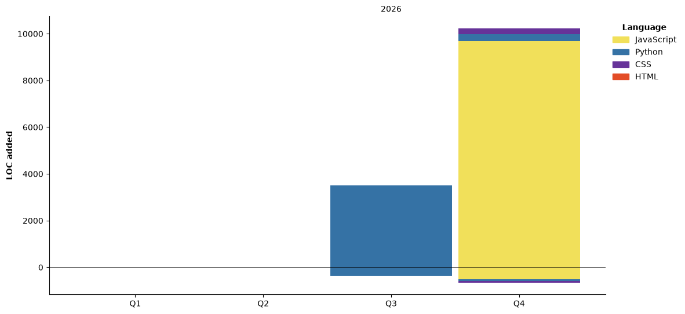

<p align="center">
  
</p>

<div align="center">
  
  
  
  
  
  <a href="https://t.me/cpxcth"></a>
</div>

<!--START_SECTION:waka-->


**🐱 My GitHub Data** 

> 📦 497 Bytes Used in GitHub's Storage 
 > 
> 🏆 108 Contributions in the Year 2026
 > 
> 🚫 Not Opted to Hire
 > 
> 📜 3 Public Repositories 
 > 
> 🔑 12 Private Repositories 
 > 
**I'm a Night 🦉** 

```text
🌞 Morning                2 commits           ░░░░░░░░░░░░░░░░░░░░░░░░░   01.83 % 
🌆 Daytime                9 commits           ██░░░░░░░░░░░░░░░░░░░░░░░   08.26 % 
🌃 Evening                67 commits          ███████████████░░░░░░░░░░   61.47 % 
🌙 Night                  31 commits          ███████░░░░░░░░░░░░░░░░░░   28.44 % 
```
📅 **I'm Most Productive on Sunday** 

```text
Monday                   18 commits          ████░░░░░░░░░░░░░░░░░░░░░   16.51 % 
Tuesday                  5 commits           █░░░░░░░░░░░░░░░░░░░░░░░░   04.59 % 
Wednesday                20 commits          █████░░░░░░░░░░░░░░░░░░░░   18.35 % 
Thursday                 15 commits          ███░░░░░░░░░░░░░░░░░░░░░░   13.76 % 
Friday                   4 commits           █░░░░░░░░░░░░░░░░░░░░░░░░   03.67 % 
Saturday                 14 commits          ███░░░░░░░░░░░░░░░░░░░░░░   12.84 % 
Sunday                   33 commits          ████████░░░░░░░░░░░░░░░░░   30.28 % 
```


📊 **This Week I Spent My Time On** 

```text
🕑︎ Time Zone: Europe/London

💬 Programming Languages: 
Python                   13 mins             ████████████████████░░░░░   78.56 % 
reg                      3 mins              █████░░░░░░░░░░░░░░░░░░░░   21.44 % 

🔥 Editors: 
VS Code                  10 mins             ███████████████░░░░░░░░░░   60.16 % 
Copilot CLI              7 mins              ██████████░░░░░░░░░░░░░░░   39.84 % 

💻 Operating System: 
Windows                  17 mins             █████████████████████████   100.00 % 
```

🤖 **AI Coding This Week** 

```text
⏱ AI Coding Time: 8 mins (49.47%)

✍️ 0 lines written by AI, 12 lines written by hand (0.0% AI-written)

🔤 16,649 Input Tokens, 1,272 Output Tokens

💵 $0.00 Estimated AI Cost This Week

🧠 1 AI Sessions, 8 AI Prompts

GPT                      0 lines             ░░░░░░░░░░░░░░░░░░░░░░░░░   00.00 % 

🔎 AI Coding Insights:
🧑‍💻 Mostly Hands-On — 0.0% of written lines came from AI
📝 Concise Prompter — average 103 characters per prompt
🔁 Iterative Prompter — average 8 prompts per session
🔍 Hands-On Reviewer — 100.0% of changed lines were hand-edited
```

**I Mostly Code in Python** 

```text
Python                   3 repos             ████████████░░░░░░░░░░░░░   50.00 % 
JavaScript               1 repo              ████░░░░░░░░░░░░░░░░░░░░░   16.67 % 
CSS                      1 repo              ████░░░░░░░░░░░░░░░░░░░░░   16.67 % 
HTML                     1 repo              ████░░░░░░░░░░░░░░░░░░░░░   16.67 % 
```


**Timeline**




 Last Updated on 17/11/2026 06:13:05 UTC
<!--END_SECTION:waka-->

<p align="center">
  
</p>

---


